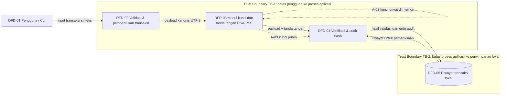

# Data Flow Diagram (DFD) — SecureWallet

Diagram ini adalah DFD tingkat konteks/dekomposisi awal. ID elemen dipakai kembali pada `threat-model.md`.

## Elemen dan aset
- **DFD-01:** pengguna/CLI; memasukkan data transaksi (A-01).
- **DFD-02:** validasi dan pembentukan payload; menangani A-01.
- **DFD-03:** modul pembuatan/penggunaan kunci dan tanda tangan; menangani A-02 dan A-03.
- **DFD-04:** verifikasi tanda tangan dan rantai hash; menangani A-01, A-04, A-05, A-07.
- **DFD-05:** penyimpanan riwayat lokal; menyimpan A-01, A-04, A-05.
- **TB-1:** input pengguna dianggap tidak tepercaya sampai divalidasi.
- **TB-2:** data yang melintasi batas proses ke penyimpanan lokal perlu diperiksa integritasnya.

## Data yang dilindungi kriptografi
- A-01: tanda tangan RSA-PSS atas serialisasi JSON deterministik.
- A-04: signature dikodekan Base64 untuk representasi teks; Base64 bukan enkripsi.
- A-05: SHA-256 menghubungkan entri audit. Ini mendeteksi perubahan lokal, tetapi bukan bukti anti-manipulasi jika penyerang dapat menulis ulang seluruh rantai.
- A-02: tidak disimpan ke repository atau file demo.
